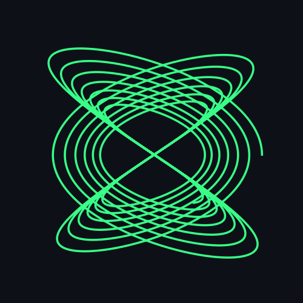
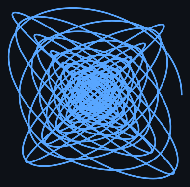

# Damped Lissajous Harmonograph

A physics-based parametric curve generator written in Python using `NumPy` and `Matplotlib`. It simulates two perpendicular damped pendulums losing energy over time to friction—created to generate my custom GitHub profile avatar from scratch.

 

## Prerequisites
Make sure you have Python installed along with `numpy` and `matplotlib`:
```bash
pip install numpy matplotlib
```

## How to Run
1. Run the Python script in your terminal:
   ```bash
   python harmonograph.py
   ```
   *(Replace `harmonograph.py` with your exact `.py` filename.)*
2. The script renders silently in the background (`Agg` backend) and outputs the high-contrast PNG image directly into your folder.

## Variables You Can Customize

| Variable | Default | What It Controls | Try Changing It To |
| :--- | :--- | :--- | :--- |
| **`f1`** | `3` | Horizontal oscillation frequency (speed along the X-axis) | `4`, `5`, or `7` |
| **`f2`** | `2` | Vertical oscillation frequency (speed along the Y-axis) | `3`, `4`, or `6` |
| **`d`** | `0.02` | Damping factor (how quickly friction shrinks the spiral inward) | `0.01` (more loops) or `0.05` (tighter spiral) |
| **`p`** | `1.57` | Phase shift in radians ($\approx \pi/2$), which opens up the loops | `0`, `0.78`, or `3.14` |
| **`t`** | `0` to `40` | Total simulation time and resolution (`5000` points) | Increase `40` to `60` if you lower `d` |
| **`color`** | `'#39ff88'` | Line color in hex format (neon green) | `'#58a6ff'` (electric blue) or `'#ff7b72'` (coral) |
| **`linewidth`** | `2.5` | Thickness of the plotted curve | `1.5` (delicate) or `3.5` (bold) |

### Fun Frequency Ratios (`f1 : f2`) to Try
* **`3 : 2`** — Classic trefoil weave (default)
* **`4 : 3`** — Dense geometric knot
* **`5 : 4`** — Intricate mesh ribbon
