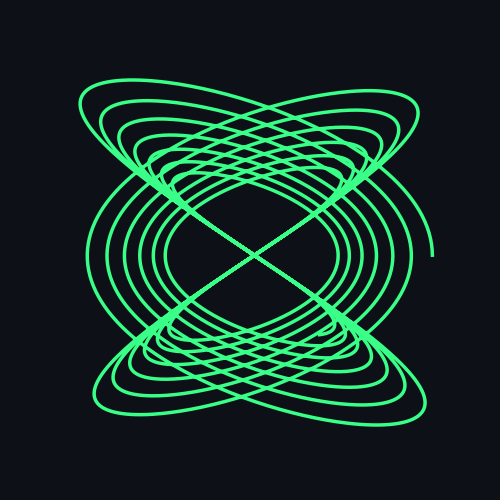

# Damped Lissajous Harmonograph

A physics-based parametric curve generator written in Python using `NumPy` and `Matplotlib`. It simulates two perpendicular damped pendulums losing energy over time to friction—originally built to generate my custom GitHub profile avatar (**V1**) and expanded into an animated harmonograph engine (**V2**).

 

## Project Overview (V1 & V2 Evolution)

* **Version 1 (Static Avatar Generator):** Focused on parametric modeling and high-contrast rendering (`#39ff88` neon green on `#0d1117` GitHub dark background) to output static PNG images (`Figure_1.png`, `Figure_2.png`).
* **Version 2 (Animated Simulation Engine):** Upgrades the static plot into a frame-by-frame physics animation using `FuncAnimation` and `PillowWriter`, tracing the pendulum's decaying spiral path in real time and exporting `harmonograph_anim.gif`.

| Aspect | Version 1 | Version 2 (Current) |
| :--- | :--- | :--- |
| **Output Format** | Static high-contrast PNG | Looping GIF (`harmonograph_anim.gif`) |
| **Rendering Engine** | Direct Matplotlib line plot | Frame-by-frame blitted `FuncAnimation` |
| **Core Purpose** | Custom GitHub profile avatar | Real-time visualization of harmonic decay |

## What's New in Version 2

* **Real-Time Path Tracing:** Uses `matplotlib.animation.FuncAnimation` with `blit=True` to progressively draw the `5000`-point curve from start to finish.
* **GIF Export via Pillow:** Automatically compiles frames into `harmonograph_anim.gif` at `100 DPI` using `PillowWriter` without requiring external FFmpeg dependencies.
* **Fixed Viewport Bounds:** Locks axis limits (`-1.1` to `1.1`) and equal aspect ratio (`1:1`) so the spiral remains centered without camera jitter as it decays inward.

## Prerequisites
Make sure you have Python installed along with `numpy`, `matplotlib`, and `pillow` (required for GIF rendering):
```bash
pip install numpy matplotlib pillow
```

## How to Run
1. Run the Python script in your terminal:
   ```bash
   python harmonograph.py
   ```
   *(Replace `harmonograph.py` with your exact `.py` filename.)*
2. The script renders silently in the background (`Agg` backend), processes `100` frames at `30` FPS, and outputs `harmonograph_anim.gif` directly into your folder.

## Variables You Can Customize

### Physics & Styling Parameters (V1 & V2)

| Variable | Default | What It Controls | Try Changing It To |
| :--- | :--- | :--- | :--- |
| **`f1`** | `3` | Horizontal oscillation frequency (speed along the X-axis) | `4`, `5`, or `7` |
| **`f2`** | `2` | Vertical oscillation frequency (speed along the Y-axis) | `3`, `4`, or `6` |
| **`d`** | `0.02` | Damping factor (how quickly friction shrinks the spiral inward) | `0.01` (more loops) or `0.05` (tighter spiral) |
| **`p`** | `1.57` | Phase shift in radians ($\approx \pi/2$), which opens up the loops | `0`, `0.78`, or `3.14` |
| **`t`** | `0` to `40` | Total simulation time and resolution (`5000` points) | Increase `40` to `60` if you lower `d` |
| **`color`** | `'#39ff88'` | Line color in hex format (neon green) | `'#58a6ff'` (electric blue) or `'#ff7b72'` (coral) |
| **`linewidth`** | `2.5` | Thickness of the plotted curve | `1.5` (delicate) or `3.5` (bold) |

### Animation Parameters (New in V2)

| Variable | Default | What It Controls | Try Changing It To |
| :--- | :--- | :--- | :--- |
| **`total_frames`** | `100` | Total number of frames rendered in the animation | `150` or `200` (longer, more detailed trace) |
| **`fps`** | `30` | Playback speed in frames per second | `24` (cinematic) or `60` (ultra-smooth) |
| **`dpi`** | `100` | Output resolution of `harmonograph_anim.gif` (`5x5` inches) | `150` (sharper lines, larger file size) |

### Fun Frequency Ratios (`f1 : f2`) to Try
* **`3 : 2`** — Classic trefoil weave (default)
* **`4 : 3`** — Dense geometric knot
* **`5 : 4`** — Intricate mesh ribbon
